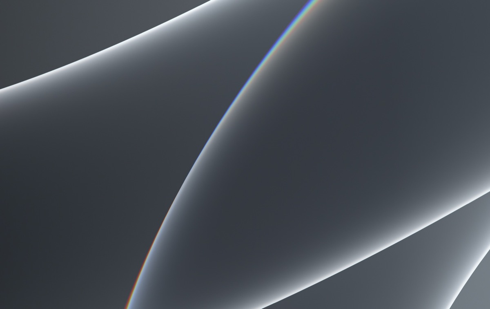

# TouchBridge

[](https://github.com/VuPhm/touch-bridge/actions/workflows/ci.yml)
[](https://github.com/VuPhm/touch-bridge/releases)
[](https://www.apple.com/macos/)
[](https://github.com/VuPhm/touch-bridge)

**TouchBridge** là tiện ích macOS native nhẹ, hiệu năng cao giúp biến màn hình phụ cảm ứng USB-C thành bề mặt thao tác trực tiếp mượt mà như máy tính bảng hoặc iPad Sidecar trên macOS.

Dự án sinh ra từ nhu cầu thực tế: mang lại trải nghiệm cảm ứng trực tiếp (Direct-Touch) tự nhiên, phản hồi tức thì và ổn định khi sử dụng hằng ngày trên MacBook.



---

## ⚡ Điểm Nổi Bật

- **Cuộn 1 ngón trực tiếp (Direct-Touch Scroll)**: Vuốt trực tiếp trên nội dung để cuộn trang 1:1 theo quán tính tự nhiên, với thuật toán đệm quán tính ngắn và dừng tức thì (tap-to-brake) không phát sinh click nhầm.
- **Kéo thả thông minh & Thao tác cửa sổ siêu tốc (Fast Path Drag)**: Kéo cửa sổ, thanh tiêu đề và mép đổi kích thước (resize edge) với độ trễ cực thấp (< 0.2ms), bỏ qua phân giải Accessibility nặng. Hỗ trợ giữ 0.24s để bôi đen văn bản hoặc kéo tập tin.
- **Chuột phải tự nhiên (Long-press Context Menu)**: Nhấn giữ 0.48s tại một điểm để mở Menu chuột phải với chỉ báo phản hồi xúc giác.
- **Cử chỉ đa điểm 2 ngón (Multi-touch Gestures)**: Tự động phân tách cử chỉ 2 ngón thành cuộn trackpad 2 chiều, thu phóng tự nhiên (Pinch-to-zoom qua `CGEventSource` pinch) và xoay tự do (Rotate).
- **Thích ứng xoay màn hình tự động (Orientation Adaptation)**: Tự động điều chỉnh ma trận chuyển đổi tọa độ theo góc xoay hiển thị của macOS (0°, 90°, 180°, 270°) mà không làm lệch profile hiệu chuẩn đã lưu.
- **Chiếm quyền độc quyền HID (Exclusive Input Seizure)**: Sử dụng `IOHIDManagerOpen(kIOHIDOptionsTypeSeizeDevice)` để triệt tiêu hoàn toàn sự can thiệp của driver chuột generic hệ thống, loại bỏ tình trạng con trỏ nhảy giật hai đầu.
- **Tiết kiệm pin & Thân thiện phần cứng**: Dừng hoàn toàn timer chạy nền khi ở trạng thái nghỉ; tự động reset trạng thái an toàn khi Sleep / Wake hoặc rút cáp màn hình để không bao giờ bị kẹt chuột.
- **Khởi động cùng máy tính (Launch at Login)**: Tích hợp chuẩn macOS `SMAppService.mainApp` hiện đại, quản lý cấu hình tiện lợi ngay tại menu bar.

---

## 🖥️ Môi Trường Đã Kiểm Chứng

| Thành phần | Cấu hình kiểm chứng thực tế | Ghi chú |
| :--- | :--- | :--- |
| **Máy tính** | MacBook Pro 2019, 16-inch, Intel Core i7 (`x86_64`), RAM 16 GB | Môi trường thử nghiệm vật lý thực tế |
| **Hệ điều hành** | macOS Sonoma 14.8.9 (Darwin 23.6.0) | Hỗ trợ macOS 13 Ventura trở lên |
| **Màn hình ngoài** | Portable Display `TYPE C` (DisplayID: `79846407`) | Độ phân giải 960 × 1280 (xoay đứng 270°) và 1280 × 960 |
| **Bộ điều khiển cảm ứng** | `USB2IIC_CTP_CONTROL` (VendorID: `0x1A86`, ProductID: `0xE5E3`) | Digitizer USB HID IIC |

> [!NOTE]
> **Phân định môi trường kiểm thử**:
> - **Kiểm thử vật lý thực tế**: Thực hiện trực tiếp trên MacBook Pro 2019 Intel (`x86_64`) kết nối màn hình cảm ứng USB-C.
> - **Kiểm thử tự động trên CI**: Chạy song song cả hai môi trường runner: Intel `x86_64` (trên macOS 13) và Apple Silicon `arm64` (trên macOS 15). Các bản build cross-compile từ arm64 sang x86_64 được định danh rõ là cross-compilation và chỉ coi là đã kiểm thử thực thi khi chạy trên host/runner Intel tương ứng.

> [!IMPORTANT]
> **Lưu ý về Bản chất Kỹ thuật (Technical Clarity)**:
> macOS không cung cấp driver màn hình cảm ứng cảm ứng đa điểm native toàn hệ thống cho màn hình ngoài như iPadOS hay Windows. TouchBridge tiếp nhận raw HID contact từ controller bằng `IOHIDManager`, khử nhiễu, phân tích cử chỉ thông minh và tổng hợp thành luồng sự kiện tương thích chuẩn của macOS CoreGraphics (`CGEvent` mouse/drag, trackpad scroll & gesture routing). Ứng dụng không sử dụng driver kernel không chứng thực và không can thiệp trái phép vào bảo mật hệ thống.

---

## 🚀 Cài Đặt & Sử Dụng

### 1. Cài đặt bản đóng gói (Pre-built Release)

1. Tải bản build phù hợp từ mục [Releases](https://github.com/VuPhm/touch-bridge/releases):
   - `TouchBridge-v1.0.0-macOS-intel.zip` (dành cho Mac Intel như MacBook Pro 2019).
   - `TouchBridge-v1.0.0-macOS-arm64.zip` (dành cho Mac Apple Silicon M1/M2/M3/M4).
2. Giải nén file `.zip`.
3. Di chuyển file ứng dụng vào thư mục `~/Applications/` (hoặc `/Applications/`).

> [!NOTE]
> **Về danh tính ứng dụng & Quyền Trợ năng (TCC)**:
> - Bản cài đặt cá nhân sử dụng đường dẫn `~/Applications/TouchBridge Dev.app` và Bundle Identifier `com.antigravity.touchbridge.dev` với chứng chỉ ký số nội bộ nhằm bảo toàn vĩnh viễn quyền Trợ năng (Accessibility) và profile hiệu chuẩn, tránh việc macOS thu hồi quyền sau mỗi lần cập nhật. Tên hiển thị trên Menu Bar và cửa sổ ứng dụng là **TouchBridge**.
> - Các bản gói tải từ GitHub Releases là bản build không chứng chỉ công chứng (notarization); khi mở lần đầu có thể cần click chuột phải → chọn *Open*.

### 2. Cấp quyền Trợ năng (Accessibility Permission)

Để phát luồng sự kiện cảm ứng và cuộn mượt mà vào hệ thống, TouchBridge cần quyền Trợ năng:
1. Khi mở app lần đầu, chọn **Mở Cài đặt Trợ năng** trong cửa sổ TouchBridge (hoặc vào *System Settings* → *Privacy & Security* → *Accessibility*).
2. Bật công tắc cho phép **TouchBridge Dev** (hoặc **TouchBridge**).
3. Cửa sổ TouchBridge sẽ chuyển ngay sang trạng thái xanh **Sẵn Sàng Hoạt Động**.

### 3. Hiệu chuẩn 4 điểm (Calibration)

Nếu vị trí chạm bị lệch so với hình ảnh hiển thị trên màn hình:
1. Mở menu TouchBridge ở Menu Bar → Chọn **Cài đặt & Trạng thái...** (hoặc chọn **Hiệu chuẩn màn hình...**).
2. Chuyển sang tab **Màn hình & Hiệu chuẩn** → Bấm **Bắt đầu hiệu chuẩn 4 điểm**.
3. Cửa sổ toàn màn hình sẽ hiện lên với 4 tâm ngắm ở 4 góc: chạm chính xác vào từng tâm ngắm theo thứ tự.
4. Sau khi hoàn tất 4 điểm góc và 2 điểm kiểm tra, ma trận hiệu chuẩn sẽ được lưu tự động và áp dụng vĩnh viễn.

---

## 🛠️ Biên Dịch Từ Mã Nguồn (Build from Source)

### Yêu cầu
- macOS 13.0 trở lên.
- Xcode 15+ hoặc Swift 5.9+ Command Line Tools.

### Lệnh biên dịch
```bash
# Clone repository
git clone https://github.com/VuPhm/touch-bridge.git
cd touch-bridge

# Kiểm tra bộ kiểm thử kiến trúc (Headless test suite - 91 bài kiểm thử)
swift run TouchBridgeProbe --test-architecture

# Chẩn đoán lưới 3x3 kiểm tra mapping và hiệu chỉnh underscan
swift run TouchBridgeProbe --print-grid-mapping

# Đóng gói và cài đặt ứng dụng có ký số phát triển (xem docs/research/DEVELOPMENT_SIGNING.md)
./scripts/build_dev_app.sh --install --restart
```

---

## 🧪 Kiểm Thử Kiến Trúc & An Toàn

Dự án tích hợp bộ kiểm thử kiến trúc độc lập (`--test-architecture`) với **91 bài kiểm thử tự động (91/91 passed, 0 failed)**, bao gồm:
- **Phép Chiếu Tọa Độ & Lưới 3×3 (Underscan Elimination)**: Kiểm chứng lưới 3×3 với sai số $< 1.0$ pt, loại bỏ độ dãn scale trục Y và sai số lệch trái do profile gốc 0° underscan.
- **Bộ Lọc Chống Rung Thích Ứng (Adaptive Anti-Shake Scroll Stabilizer)**: Triệt tiêu micro-jitter khi dừng tay, tích lũy subpixel cho vuốt chậm trơn tru, đảo chiều tức thì và triệt tiêu văng quán tính ngoài ý muốn khi dừng tay trước khi nhấc.
- **Ma trận tọa độ (Calibration & Transform Invariants)**: Đảm bảo độ chính xác chuyển đổi không gian màn hình, thích ứng 4 góc xoay (0°, 90°, 180°, 270°).
- **Hệ thống cử chỉ (Gesture State Machine)**: Kiểm chứng Tap, Double-tap, Hold context menu, Drag lock, 1-finger inertial scroll, 2-finger pinch/zoom.
- **An toàn giao diện (Safety Invariants)**: Đảm bảo không bao giờ tồn tại trạng thái kẹt mouse-down khi ngắt kết nối hoặc Sleep máy tính; chuột vật lý luôn có quyền tiếp quản ưu tiên.

Chạy kiểm thử:
```bash
swift run TouchBridgeProbe --test-architecture
```

---

## 📂 Cấu Trúc Dự Án

```
touch-bridge/
├── Sources/
│   └── TouchBridgeProbe/          # Mã nguồn chính
│       ├── AppDelegate.swift      # Single instance & vòng đời ứng dụng
│       ├── MenuBarController.swift# Menu bar icon & điều khiển nhanh
│       ├── StatusSettingsWindowController.swift # Cửa sổ Cài đặt AppKit 4-tab
│       ├── TouchBridgeRuntime.swift # Quản lý kết nối HID, Display & Calibration
│       ├── TouchGestureRecognizer.swift # Bộ nhận diện cử chỉ 1 ngón & 2 ngón
│       ├── GestureActionRouter.swift # Điều hướng & chuyển giao sự kiện
│       ├── DirectTouchArbiter.swift # Đệm chuyển tiếp giữa cuộn và click
│       ├── SubpixelAccumulator.swift # Tích lũy cuộn mượt mà subpixel 2D
│       └── ...
├── scripts/
│   ├── build_dev_app.sh          # Script build, ký số và đóng gói .zip
│   ├── install_dev_app.sh        # Script cài đặt nhanh
│   └── test_dev_signing.sh       # Script kiểm tra hồi quy ký số
├── docs/
│   ├── images/                   # Ảnh chụp giao diện và sơ đồ
│   └── research/                 # Toàn bộ nhật ký và báo cáo thử nghiệm gốc (DEVELOPMENT_SIGNING.md,...)
├── .github/
│   └── workflows/ci.yml          # GitHub Actions headless build & test (x86_64 & arm64)
├── TouchBridgeCalibration.json   # Profile hiệu chuẩn mẫu
├── VERSION                       # Phiên bản phát hành
└── README.md
```

---

## 📄 Bản Quyền & Giấy Phép

Dự án cá nhân phục vụ cấu hình phần cứng nội bộ. Mọi quyền được bảo lưu bởi tác giả.
